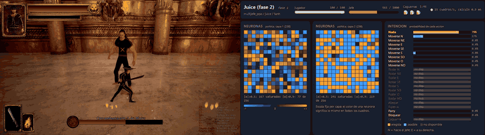
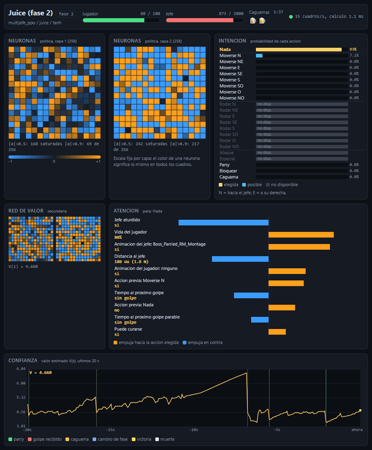

# Dark México RL

[](https://github.com/Ordi94/dark-mexico-rl/actions/workflows/ci.yml)

[Español](README.md)

A neural network that learned to fight the bosses of [Dark México](https://store.steampowered.com/app/4346760/), a single-player action game by NorDreams. It first imitates a rule-based bot I wrote by hand, then improves on its own with PPO. I wanted to see whether a network could beat a boss I never managed to beat myself.

This is an educational project. It is unofficial and not affiliated with NorDreams. You need to own the game. The repository contains no game files.

The documentation is in Spanish. This page is a short summary.

## Demo



Fifteen seconds of a real fight against Juice (second phase): the game on the left, the live panel on the right. The network mostly waits, and when the hit comes the Parry bar jumps to 100% and the AI parries.



Fourteen seconds of the full panel in a real fight against Juice (second phase): the neurons of both policy layers, the probability of each action, the inputs that weighed most in the decision and the value estimate V(s) of the last 20 s, with a green mark at every parry. It is explained in [docs/02-ver-pelear.md](docs/02-ver-pelear.md).

## Results

100 fights per boss, boss at full health, first phase of each boss, deterministic policy. All numbers come from the real game.

| Boss | Rule-based bot (50 fights) | Imitation (80 fights) | PPO (100 fights) |
|---|---|---|---|
| Juice | 66% | 76% | 92% |
| AMLO + Chamuco (back to back) | 100% | 100% | 92% |
| Chamuco | 100% | 100% | 99% |
| Chupacabras | 98% | 100% | 100% |
| Mean | 91.0% | 94.0% | 95.75% |

With 100 fights a rate carries about 5 points of uncertainty, so the gain in the mean is within noise. The real change is Juice: imitation never went past 76-79% and PPO reached 92%. PPO from scratch ended at 0% wins, and three rounds of DAgger did not help. The full story is in [docs/05-lo-que-aprendimos.md](docs/05-lo-que-aprendimos.md).

The trained models are not in the repository. They are published in the Releases section.

## How it works

A UE4SS mod written in Lua runs inside the game. It reads the player and boss state, applies the network's actions and advances the game clock in fixed 1/30 s steps. It talks to Python over two Windows named pipes, and the game waits for the next command, so the simulation only advances when Python says so. Without a window (`-nullrhi`) one instance runs about 34 times faster than real time. The network sees 640 numbers (160 per instant, the last 4 stacked), picks one of 22 actions, and the game masks the ones that cannot be executed at that moment. Details in [docs/03-como-funciona.md](docs/03-como-funciona.md).

## Quick start

1. Buy and install Dark México on Steam.
2. Install UE4SS v3.0.1-1176 and the `DarkMexicoBridge` mod ([docs/01-instalacion.md](docs/01-instalacion.md)).
3. Create a Python 3.12 environment and install the project:
   ```powershell
   python -m venv .venv
   .\.venv\Scripts\python.exe -m pip install -e ".[dev]"
   ```
4. Check the bridge against the real game: `.\.venv\Scripts\python.exe scripts\bridge_smoke.py`
5. Download `darkmexico-multijefe-ppo.zip` from Releases and save it as `runs\multijefe_ppo\mejor.zip`.
6. Watch it fight: `.\scripts\ver_pelea.ps1 -Multijefe -Jefe amlo -Panel`

If the game is not in the default Steam path, set `DARKMEXICO_DIR` to its install folder.

## Requirements

- Windows 10 or 11, Python 3.12.
- Dark México bought on Steam. I tested build 23613382. A game update can rename internal classes and animations and break the mod until they are measured again.
- About 8 cores to train (about 450 steps per second with 6 game instances on an i7-14700KF) and 1 GB of RAM per windowless instance. I did not test with fewer cores.
- A GPU is optional. It only speeds up the imitation fit.

## How I built it

I built this project with help from [Claude Code](https://claude.com/claude-code), Anthropic's coding assistant. The assistant wrote much of the code, tests and documentation. My part was deciding what to build, testing every stage in the actual game, catching things that didn't add up (early on the mod moved the camera while the character stayed behind) and choosing the direction: imitate the bot first, train every boss with a single network, and stop training once it stopped improving.

I also used it to learn. The [interactive guide](docs/guia/index.html) (in Spanish) came out of my own questions about softmax, Tanh and PPO. If you are starting out, I'd suggest the same: ask about anything you don't understand and check everything in the real game, because that's where almost every bug showed up.

## Credits and notice

Dark México belongs to NorDreams: <https://store.steampowered.com/app/4346760/>. This project is not affiliated with or endorsed by NorDreams or Steam. It is for single-player use only and includes no game files. The mod is installed into your own copy of the game.

The mod relies on [UE4SS](https://github.com/UE4SS-RE/RE-UE4SS) (v3.0.1-1176), which is not redistributed here. Training uses Stable-Baselines3, sb3-contrib, Gymnasium and PyTorch.

## License

MIT, see [LICENSE](LICENSE). It covers the code in this repository, not the game.
