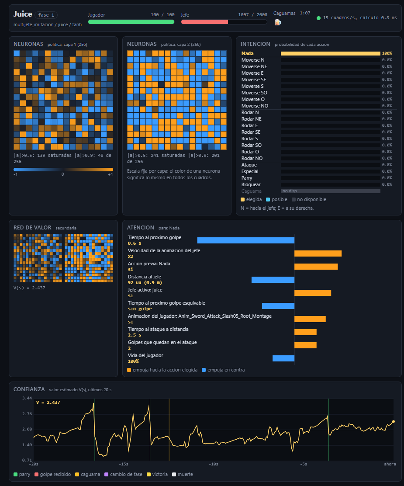

# Ver pelear al modelo

Quince minutos si ya hiciste la [instalación](01-instalacion.md). No entrenas nada: descargas un modelo, abres el juego con una ventana y miras.

## 1. Descargar el modelo

En la sección Releases del repositorio hay dos modelos:

| Archivo | Qué es | SHA-256 |
|---|---|---|
| `darkmexico-multijefe-ppo.zip` | La política final: imitación mejorada con PPO. Es la que gana más. | `817eacba783e44a7e89c524aca7f45d38bf2f2f0abe112b0b740952667549a99` |
| `darkmexico-multijefe-imitacion.zip` | La red que copia al bot de reglas. Es el punto de partida del PPO. | `e7253bf92d8c10cba09fb9ea8abbf64fd2c3a871e1ffaba8f3334b69fe3a7360` |

Cada uno trae su ficha con los resultados medidos y las limitaciones (`MODEL_CARD.md`). Los zips no se descomprimen: PyTorch y Stable-Baselines3 los leen tal cual. Cópialos con estos nombres, desde la raíz del repositorio:

```powershell
New-Item -ItemType Directory -Force runs\multijefe_ppo, runs\multijefe_imitacion | Out-Null
Copy-Item .\darkmexico-multijefe-ppo.zip        runs\multijefe_ppo\mejor.zip
Copy-Item .\darkmexico-multijefe-imitacion.zip  runs\multijefe_imitacion\mejor.zip
Get-FileHash runs\multijefe_ppo\mejor.zip -Algorithm SHA256
```

Compara el hash con el de la tabla. Un zip de modelo de Stable-Baselines3 contiene un pickle de la configuración; no cargues modelos de gente que no conozcas.

## 2. Abrir la pelea

```powershell
.\scripts\ver_pelea.ps1 -Multijefe -Jefe amlo
```

`-Jefe` acepta `juice`, `amlo`, `chamuco` y `nahual` (el Chupacabras; así lo llama el código del juego). El script abre una ventana de 1280x720, carga el mapa del jefe y deja pelear al modelo una vez. Mientras corre, la pelea transcurre en tiempo real: aunque el juego puede ir más rápido, `ver_pelea` espera entre decisiones para que 1 s de juego sea 1 s de reloj. La simulación es la misma que en el entrenamiento.

Algunas opciones:

| Opción | Efecto |
|---|---|
| `-Imitacion` | Usa `runs\multijefe_imitacion\mejor.zip` en lugar del PPO. |
| `-Modelo ruta.zip` | Usa otro zip. |
| `-Episodios 3` | Juega tres peleas seguidas. |
| `-MaxSegundos 60` | Corta a los 60 s de reloj real. |
| `-Panel` | Abre el panel de neuronas (siguiente sección). |

Al terminar, el juego tarda en cerrar (hasta unos 100 s en mis pruebas). No lo mates a mano; el script lo cierra.

Si entrenas al mismo tiempo, detén primero el entrenamiento (`.\scripts\detener.ps1 -Multijefe`). La ventana y 6 instancias compiten por CPU y la pelea se ve a trompicones.

## 3. El panel de neuronas

```powershell
.\scripts\ver_pelea.ps1 -Multijefe -Jefe juice -Panel
```

Abre `http://127.0.0.1:8765/` en tu navegador antes de lanzar el juego. La página se reconecta sola, así que puedes cerrarla y abrirla cuando quieras. Pensé el diseño para unos 900 px de ancho, al lado de la ventana del juego. Con `-PanelPuerto 8800` cambias el puerto y con `-SinNavegador` no se abre el navegador.

El panel solo lee. No cambia la acción que elige la política. El servidor escucha en `127.0.0.1`, valida `Host` y `Origin`, y se cierra al terminar la pelea. Si el puerto está ocupado, el comando falla antes de lanzar el juego.



Cómo leerlo:

| Parte | Qué muestra | Cómo leerla |
|---|---|---|
| Encabezado | Jefe y fase, vida de los dos, caguamas, tiempo de pelea, estado de la conexión | Punto verde: llegan cuadros. Amarillo: conectado, sin pelea. Rojo: sin conexión. |
| Neuronas | Las 256 neuronas de cada una de las dos capas ocultas de la política, en dos cuadrículas de 16x16 | Azul es negativa, naranja es positiva, oscuro es cerca de cero. La escala es fija (de -1 a 1, el límite de `Tanh`), así que un color significa lo mismo en todos los cuadros. |
| Red de valor | Las dos capas de la red que estima cuánta recompensa falta, en pequeño | Igual que arriba. |
| Intención | La probabilidad de cada una de las 22 acciones | Es la distribución con la que el modelo decide, con la máscara aplicada. Gris con "no disp." es una acción que el juego no acepta en ese momento. Amarillo es la elegida. |
| Atención | Las 10 entradas que más pesaron en la decisión | Es el gradiente del valor de la acción elegida respecto a la entrada, sumado sobre las 4 copias apiladas. Naranja empuja hacia la acción, azul empuja en contra. |
| Confianza | El valor estimado V(s) de los últimos 20 s | Marcas: parry exitoso (verde), golpe recibido (rojo), caguama (ámbar), cambio de fase (morado), victoria (amarillo), muerte (blanco). |

Tres cosas que aprendí mirándolo:

- Antes de un parry exitoso, la probabilidad de la acción parry está en 0.96 o más en los cuatro cuadros previos. Contra una media de 0.02 en toda la pelea, la red sabe cuándo viene el golpe.
- El valor baja antes del golpe y no en el golpe. La red ve venir el ataque porque una de sus entradas es el tiempo hasta el siguiente impacto.
- La atención es sensibilidad local, no causalidad. Con capas `Tanh` saturadas el gradiente puede ser pequeño aunque la entrada sea decisiva.

El panel añade entre 1 y 5 ms por decisión frente a un periodo de 66 ms. En tres peleas completas no se perdió ningún cuadro y el juego avanzó al mismo ritmo que el reloj (relación de 1.0003).

## 4. Si algo falla

| Problema | Qué hacer |
|---|---|
| `no existe el modelo ...` o `la corrida ... no tiene modelo guardado` | Revisa que el zip esté en `runs\multijefe_ppo\mejor.zip` o pásalo con `-Modelo`. |
| `-Panel solo esta disponible con -Multijefe` | El panel usa la observación v2, que solo tienen los modelos multi-jefe. |
| El puerto del panel está ocupado | Cambia con `-PanelPuerto`. |
| La ventana se queda en negro | Espera: la carga del mapa tarda unos segundos. Si pasa de un minuto, revisa `ue4ss\UE4SS.log`. |
| El modelo pierde mucho contra Juice | Es esperable: el 8% de las peleas contra Juice las pierde en su primera fase. Los números están en [docs/05-lo-que-aprendimos.md](05-lo-que-aprendimos.md). |

La observación, las acciones y la máscara están descritas en [docs/03-como-funciona.md](03-como-funciona.md).
