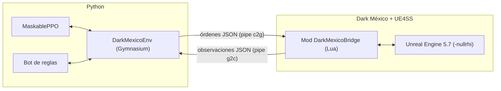
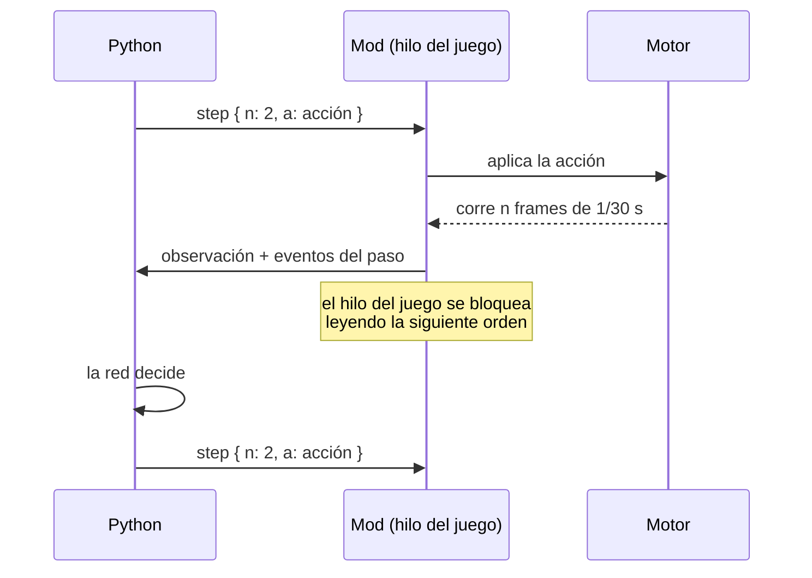

# Cómo funciona

Este documento explica las piezas por orden de aparición: el mod dentro del juego, el canal con Python, el reloj del juego, lo que ve la red, lo que puede hacer y por qué recibe premio. Todo lo que cito como medido salió del juego real. Hay dos diagramas interactivos para abrir en el navegador: [visión general](guia/general.html) y [arquitectura detallada](guia/arquitectura.html). También existe una [guía interactiva](guia/index.html) para quien no conoce el aprendizaje por refuerzo. Son páginas HTML autocontenidas: ábrelas con el navegador desde tu copia del repositorio, o con GitHub Pages si lo activas sobre `docs/`.

## Las piezas

El código está en capas, de adentro hacia afuera:

| Capa | Dónde | Qué hace |
|---|---|---|
| Mod | `mod/DarkMexicoBridge` | Lee el estado del juego, aplica acciones, reinicia peleas, bloquea el guardado y los logros. |
| Cliente | `src/dmbridge` | Lanza instancias del juego, abre los pipes y habla el protocolo. No sabe nada de aprendizaje. |
| Dominio | `src/dmrl/dominio` | Reglas puras sin entrada ni salida: observación, acciones, máscara, recompensa, bot, tabla de golpes. |
| Aplicación | `src/dmrl/aplicacion` | Entorno Gymnasium, imitación, PPO, evaluación, panel. |
| Entrada | `src/dmrl/entrada` | La línea de comandos `python -m dmrl ...`. |

## El mod y UE4SS

[UE4SS](https://github.com/UE4SS-RE/RE-UE4SS) se carga con `dwmapi.dll` y ejecuta scripts de Lua dentro del hilo del juego. Desde ahí se pueden leer las propiedades de los Blueprints (vida, estamina, montage activo), llamar funciones del juego (`Respawn_Player`, `OpenLevel`) y engancharse a funciones (`TakeDamage`, `Parry Window ON`).

El mod solo se activa si el proceso arranca con `DMB_TRAINING=1`. Sin esa variable imprime que está inactivo y termina. Eso importa porque UE4SS carga todos los mods en cualquier arranque del juego.

Dos protecciones se activan con la variable, y si alguna falla `reset` se niega a empezar un episodio:

- Se anula `SaveGameToSlot`: la victoria contra un jefe llama dos veces a esa función y escribiría tu partida.
- Se pone a 0 el progreso de logros.

## Dos pipes y un juego que espera

Elegí named pipes de Windows porque `io.open("\\\\.\\pipe\\...")` funciona desde Lua sin bibliotecas extra. Cada instancia usa dos: `darkmexico_<id>_c2g` (Python manda órdenes) y `darkmexico_<id>_g2c` (el juego responde). El CRT de MSVC no deja alternar lectura y escritura en el mismo `FILE*`, y por eso son dos. Cada mensaje es un objeto JSON en una línea. Lo medí contra un formato binario: el frame del motor cuesta unos 0.9 ms y un formato binario ahorraría 0.1 ms, así que me quedé con JSON.

El diálogo es de tipo lockstep:

Después de responder, el mod bloquea el hilo del juego leyendo la siguiente orden. La simulación solo avanza cuando Python lo pide, así que da igual cuánto tarde Python en decidir. Un paso de 2 frames tarda 1.9 ms (mediana), de los cuales casi todo es el motor.

Las órdenes son pocas: `hello`, `reset`, `step`, `state`, `config`, `close` y, solo con `DMB_DEBUG=1`, `exec` para correr Lua en el juego (lo uso en las mediciones). Una acción es un diccionario con el botón de un disparo (`rb`, `y`, `b`, `x`, `rs`), `lb` y `lt` mantenidos, el movimiento `mx`, `my` y el marco del movimiento. Lo desconocido se rechaza: la validación es una lista de valores admitidos.

Si Python muere, el juego no se queda colgado: el lanzador mete cada instancia en un Job Object de Windows con `KILL_ON_JOB_CLOSE`, y Windows las cierra. Si el juego deja de responder, el cliente vence a los 30 s y mata la instancia. Si ningún cliente se conecta, el mod cierra el juego a los 120 s.

## El reloj: paso fijo y sin ventana

Esta es la razón de que el entrenamiento sea posible. Con `-UseFixedTimeStep` el motor avanza 1/30 s de juego por frame y no espera al reloj, así que corre tan rápido como da el procesador. Con `-nullrhi` no crea ventana ni toca la GPU. Juntos:

| Modo | Segundos de juego por segundo real |
|---|---|
| Dilatación de tiempo 5x (lo primero que probé) | 5 |
| Paso fijo con ventana | unos 1.9 (el motor dibuja a 56 fps) |
| Paso fijo con `-nullrhi` | 34 |

El combate es el mismo con y sin ventana: la misma secuencia de golpes recibidos, el mismo daño y todos los parries acertados en las pruebas. Probé también pasos de 1/60 s, 1/20 s, 1/15 s y 1/10 s. A 1/15 se pierde un 35% de los golpes que da el jugador y a 1/10 se rompe el parry, así que elegí 30 Hz de simulación y una decisión cada 2 frames (15 Hz). Para `ver_pelea`, el cliente espera entre decisiones hasta que el reloj real alcanza el tiempo de juego y la pelea se ve a velocidad normal.

El perfil `training` del lanzador agrega `-corelimit=2`: la misma velocidad con un 18% menos de CPU. Una instancia ocupa unos 1.8 núcleos y 0.65 GB. El total se estanca en unos 75 s de juego por segundo real a partir de 4 instancias, y no pude atribuirlo a la cantidad de núcleos, a los hilos del motor ni al canal. Con 6 instancias el entrenamiento da unos 450 pasos por segundo.

## Lo que ve la red: observación v2

160 números por instante en [0, 1] (cosenos y senos en [-1, 1]). La red recibe los últimos 4 instantes apilados, 640 números. La tabla completa con cada índice está en [referencia/ESPECIFICACION_OBSERVACION_V2.md](referencia/ESPECIFICACION_OBSERVACION_V2.md), generada por el mismo código que construye el vector (`python -m dmrl especificacion-v2`).

| Bloque | Contenido |
|---|---|
| Jugador (35) | Vida, estamina (le llamo Resistencia, como el juego), caguamas, poder, si bloquea, si bebe, ventana de parry, si puede atacar, rodar o curarse, velocidad, tiempo dentro del montage, montage activo en one-hot. |
| Jefe (identidad y estado) | Quién es (one-hot de 5 identidades), vida de su actor, si es la segunda fase, si está aturdido, si ataca, velocidad. |
| Montage del jefe | Tiempo dentro del montage, tiempo restante, velocidad de reproducción, montage activo en one-hot sobre un vocabulario de 64 montages que une a los cuatro jefes. |
| Amenazas | Segundos hasta el siguiente golpe, si se puede parar, y datos de los ataques a distancia (rayo, katanas, ráfagas). Se calculan con la tabla de golpes de cada jefe. |
| Relativo | Distancia y ángulo del jefe en el marco del jugador, y hacia dónde mira. |
| Contexto | Acción anterior en one-hot y tiempo de episodio. |

La parte que más peso tuvo es la de amenazas. Medí en qué segundo de cada animación conecta cada golpe y si se puede parar. La red no tiene que aprender eso sola; recibe "falta 0.2 s para un golpe parable". En [docs/06](06-medir-un-jefe.md) está cómo se mide. Hay una trampa: el juego detiene la animación unas décimas de segundo al conectar o recibir golpes, así que el tiempo de cada golpe se recalcula en cada observación con la posición actual de la animación. Una hora de inicio fija desfasaba los golpes hasta 0.1 s y el parry fallaba.

La observación v1 (112 números, un solo jefe) sigue cargando. [referencia/ESPECIFICACION_OBSERVACION.md](referencia/ESPECIFICACION_OBSERVACION.md) la describe.

## Lo que puede hacer: 22 acciones y una máscara

| Índice | Acción |
|---|---|
| 0 | Nada |
| 1 a 8 | Moverse en 8 direcciones (0 grados es hacia el jefe, +45 hacia su derecha) |
| 9 a 16 | Rodar (la maniobra) en esas 8 direcciones |
| 17 y 18 | Ataque (RB) y especial (Y) |
| 19 | Parry: LB pulsado en esta decisión y soltado en la siguiente |
| 20 | Bloqueo sostenido: LB mientras se repita |
| 21 | Tomar caguama (X) |

Las direcciones se definen en el marco del jefe y no de la cámara, para que no dependan de dónde mira la cámara. El enfoque (lock-on) lo activa el entorno cuando el jefe está a menos de 480 unidades, porque el personaje necesita mirar al jefe al atacar y a mayor distancia el enfoque no engancha.

Antes de que la red elija, una máscara marca las acciones que el juego va a ignorar y la red les asigna probabilidad cero. Salió de medir cuándo una acción tiene efecto:

- Con estamina 0 el juego ignora rodar, atacar y casi siempre el especial. La máscara exige estamina de al menos 0.02.
- Un combo nuevo solo entra pasado el 25% de la animación de ataque (2-11% de efecto antes, 45-90% después).
- El especial exige `Power >= 1.0` exacto. La barra sube 0.1 por golpe y diez sumas dan 0.9999999999999999. El JSON redondea a 9 cifras y mostraba `1`, así que el primer bot gastaba el 36% de sus decisiones en un especial que el juego rechazaba. El mod ahora manda `power_ready`.
- Rodar cancela ataque, bloqueo y contraataque, y LB se ignora en la reacción fuerte.

Validé la máscara con 150 episodios donde el 40% de las acciones eran al azar ignorándola: con la máscara válida, rodar tiene efecto en el 99% de los casos; con la inválida, en el 6%.

Un detalle del rodar: toma la dirección del último vector de entrada que el juego consumió, no el del mismo frame. Con botón y movimiento juntos rueda siempre hacia atrás. El mod manda el movimiento un frame antes y el botón en el siguiente.

## La recompensa

Por cada paso de decisión:

| Término | Valor |
|---|---|
| Daño al jefe | +1/100 por punto |
| Daño recibido | -1/50 por punto de vida real perdida (un golpe parado no cuenta) |
| Parry exitoso | +0.5 |
| Curación | +1/100 por punto recuperado, solo si la vida era menor de 60 |
| Bebida interrumpida | -0.05 |
| Pasar a la fase 2 | +2, una vez |
| Victoria / muerte | +10 / -5 |
| Cada paso | -0.001 |

El daño al jefe coincide con la caída de su vida que lee el juego (diferencia máxima 5e-7 en 20 episodios). Son los coeficientes por defecto de `ConfigRecompensa`. Lo que decidió si la red aprendía o no no fue la recompensa sino de dónde partía, y eso está en [docs/05](05-lo-que-aprendimos.md).

## Episodios, jefes y reinicios

Un episodio es una pelea. Termina por victoria, por muerte del jugador (sin esperar los 10 s de la pantalla de muerte) o a los 360 s de juego. Juice vive en `LVL_Boss`. AMLO, el Chamuco (que es la segunda fase de AMLO) y el Chupacabras viven en `LVL_AMLO`. Los jefes son datos: `data/jefes/*.json` guarda por jefe las clases, la vida, el vocabulario de animaciones y la tabla de golpes.

Reiniciar con `OpenLevel` tardaba 2.6 s en `LVL_AMLO`. Por eso hay un reinicio en sitio que regenera al jugador con `Respawn_Player`, destruye lo que sobra y genera al jefe con `BeginDeferredActorSpawnFromClass`: 0.05 a 0.12 s. Cada 150 episodios hay una recarga completa del mapa para acotar la memoria (200 reinicios seguidos subieron 140 MB).

## Un problema de estabilidad

Con reinicios cada pocos segundos el juego caía con `EXCEPTION_ACCESS_VIOLATION` dentro de `UE4SS.dll`, cada 13 a 46 reinicios. Con cdb sobre los minidumps vi que UE4SS resolvía propiedades sobre clases ya liberadas. Medí que tras cada `OpenLevel` el recolector de basura descarga todas las clases Blueprint y las vuelve a cargar en otra dirección. El mod ahora cuelga una `ObjectLibrary` de un singleton del motor con referencias fuertes a las 114 clases Blueprint. Con eso las direcciones no cambian y hubo 1409 reinicios seguidos sin una caída. Más de esto en [docs/05](05-lo-que-aprendimos.md).
